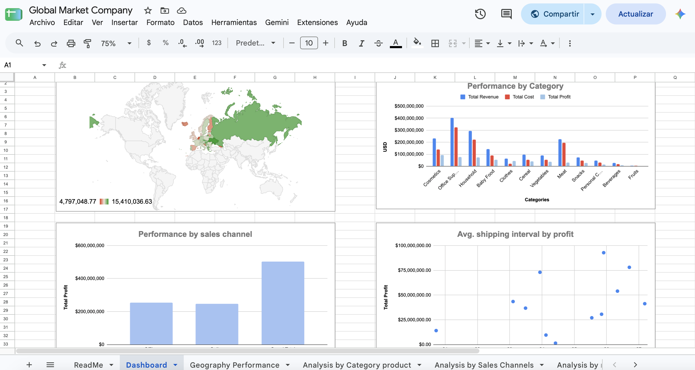

# 📊 Global Market Company - Sales & Profit Data Analysis (Google Sheets)

🔗 **[View Interactive Google Sheets Workbook](https://docs.google.com/spreadsheets/d/1OXP8yWRzGdCLHfCJ5KAo2knK1Qx8XEUUWnq5l-E_jms/edit?usp=sharing)**

## 📌 Project Overview
An end-to-end commercial and financial data analysis of **Global Market Company** covering global sales from **2010 to 2017**. Built entirely in **Google Sheets**, this project transforms raw transactional data into executive insights using statistical imputation, dynamic pivot tables, Pareto (ABC) inventory classification, and visual dashboards.

## 🧹 Data Cleaning & Preparation
* **Missing Value Imputation:** Imputed missing records in *Units Sold* (0.15% of dataset) using the column median to preserve volume without skewing averages.
* **Error Standardization:** Handled `#N/A` errors in *Country Code* using `IFNA` functions, standardizing unmapped records under an `"Unknown"` label to maintain pivot table integrity.
* **Geographic Logic:** Manually resolved an unmapped record for the `ATA` code, assigning `"Antarctica"` to its region and sub-region fields.

## 🔍 Key Business & Financial Insights
* **Pareto / ABC Analysis:** Just **7 out of 12 product categories** (Cosmetics, Office Supplies, Household, Baby Food, Clothes, Cereal, and Vegetables) generate **84% of total net profit**. Meanwhile, Personal Care, Beverages, and Fruits contribute less than 5% combined, signaling an opportunity for inventory optimization.
* **Volume vs. Profitability:** *Office Supplies* leads in transaction volume, whereas *Cosmetics* is the #1 driver of net profit.
* **Geographic Performance & Data Anomaly:** Western Europe leads global profits, peaking in 2012 before a steady decline through 2017. Additionally, the analysis uncovered a major `"Unknown"` geographic bucket driving significant revenue, highlighting a critical need to audit dark-funnel tracking.
* **Channel & Logistics Efficiency:** Online and Offline channels maintain a balanced **50/50 split** in revenue and profit. Furthermore, profit margins remain unaffected by shipping duration, proving that longer delivery windows do not erode profitability.
* **Day-of-Week Dynamics:** Sunday generates the highest gross revenue, while **Thursday yields the highest net profit**, and Wednesday demonstrates peak operational margin efficiency.

## 🛠️ Skills & Functions Applied
* **Google Sheets / Excel:** Pivot Tables, `IFNA`, `MEDIAN`, Cumulative Percentage Calculations (ABC Analysis), Geographic Map Charts, Combo Charts, and Scatter Plots.
